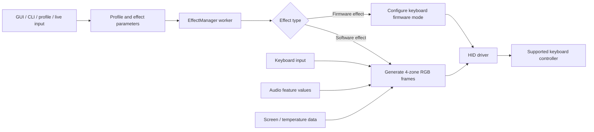

# Legion RGB Control — Technical Specification

> **Standalone, source-grounded reference** for the Legion RGB Control Rust workspace: architecture, supported hardware, effect execution, input/audio processing, data formats, persistence, Windows background mode, and build requirements.
>
> **Version:** app `0.20.8` · **Rust edition:** 2021 · **Workspace crates:** 3 · **Lighting zones:** 4

## Table of contents

- [1. Purpose and scope](#1-purpose-and-scope)
- [2. System architecture](#2-system-architecture)
- [3. Startup and manager lifecycle](#3-startup-and-manager-lifecycle)
- [4. Hardware and HID driver](#4-hardware-and-hid-driver)
- [5. Color model and driver API](#5-color-model-and-driver-api)
- [6. Built-in effects](#6-built-in-effects)
- [7. Keyboard input and typing effects](#7-keyboard-input-and-typing-effects)
- [8. Audio visualization](#8-audio-visualization)
- [9. Ambient light and temperature](#9-ambient-light-and-temperature)
- [10. Custom JSON effects](#10-custom-json-effects)
- [11. GUI, palette, and tray](#11-gui-palette-and-tray)
- [12. Command-line interface](#12-command-line-interface)
- [13. Profiles and persistence](#13-profiles-and-persistence)
- [14. Apply until shutdown (Windows)](#14-apply-until-shutdown-windows)
- [15. Errors, limitations, and safety boundaries](#15-errors-limitations-and-safety-boundaries)
- [16. Build and validation](#16-build-and-validation)
- [17. Source code map](#17-source-code-map)
- [18. Extending the application](#18-extending-the-application)

---

## 1. Purpose and scope

Legion RGB Control is a desktop application for configuring the four independently addressable RGB zones on supported Lenovo Legion-family keyboards. It provides:

- A GUI for selecting effects, configuring colors and other effect parameters, and managing profiles and custom effects.
- A CLI for listing effects, applying profiles, and loading JSON profiles/effects.
- A Rust HID driver that discovers supported keyboard controllers and sends lighting reports.
- Global keyboard input for typing-reactive effects.
- Screen-driven and temperature-driven effects.
- On Windows, audio-reactive lighting and an optional background helper that continues an explicitly applied built-in effect after the GUI closes.

The application schedules effects and transforms user settings or live inputs into keyboard API calls. The driver owns device matching and HID report encoding. The input crate observes physical key transitions without consuming keystrokes.

### Out of scope

This is not a general RGB framework. It does not provide per-key lighting, arbitrary keyboard discovery, user-authored Rust effect code, speech recognition, or general-purpose audio recording. Actual operation depends on supported hardware, OS permissions, native build dependencies, and available system endpoints/sensors.

## 2. System architecture

The root Cargo workspace uses resolver version 2 and contains three packages:

| Crate | Package | Responsibility | Main interfaces |
|---|---|---|---|
| `app/` | `legion-kb-rgb` | GUI, CLI, settings, profiles, effect manager, effect modules, custom effect runner, Windows helper/IPC, audio feature processing | `main.rs`, `cli.rs`, `gui::App`, `EffectManager`, `Profile` |
| `driver/` | `legion-rgb-driver` | Supported-device discovery and HID operations; keyboard lighting state, report construction, and range checks | `get_keyboard()`, `Keyboard`, `BaseEffects`, `SPEED_RANGE` |
| `input/` | `legion-input` | Cross-platform global key observation, normalized key values, event subscriptions, and pressed-key tracking | `Input`, `EventKind`, `Key` |

### Main data path



### Main dependencies

- **GUI and tray:** `eframe`/`egui`, `egui-notify`, `egui_file`, `tray-icon`, `image`.
- **CLI and serialization:** `clap`, `serde`, `serde_json`, `strum`.
- **Runtime and errors:** `crossbeam-channel`, `single-instance`, `thiserror`, `error-stack`, `color-eyre`.
- **Effects and capture:** `rand`, `scrap`, `fast_image_resize`, `photon-rs`, `sysinfo`; Windows audio capture uses `wasapi`.
- **Platform input:** Windows uses `windows-sys`; Linux uses `evdev` and `nix`; Linux tray integration uses GTK.
- **Device access:** `hidapi` in `legion-rgb-driver`.

## 3. Startup and manager lifecycle

### Application startup

1. `app/src/main.rs` configures platform-specific panic handling and dispatches through `cli::try_cli()`.
2. CLI parsing selects GUI startup, one-shot CLI work, hidden background-helper mode, or exit.
3. GUI startup creates the tray where supported, constructs `gui::App`, and starts `eframe::run_native` with the window title **Legion RGB**.
4. The GUI has a GUI-specific single-instance guard. The effect manager independently reserves keyboard ownership using the package name. This permits a GUI to reconnect to a helper that owns the keyboard without taking over the device twice.

### Effect manager

`EffectManager::new()` obtains the supported HID keyboard, attempts to create an optional `Input`, creates a message channel and worker thread, and keeps the single-instance reservation in the worker-owned `Inner`.

The worker processes:

- `Message::Profile` — stop the current effect and apply a profile.
- `Message::CustomEffect` — stop the current operation and run the custom step sequence.
- `Message::Exit` — end the worker.

GUI mode coalesces queued profile messages to the latest update. CLI mode consumes one message at a time. When applying a profile, the manager clamps built-in speed to the driver range, configures brightness, then dispatches the selected effect.

### Cancellation and shutdown

Effects run synchronously on the manager worker. Every animation loop must poll the stop signal so profile changes and shutdown remain responsive.

| Signal | Purpose |
|---|---|
| `manager_stop_signal` | Ends the active effect/custom loop when replacement or shutdown is requested. |
| `keyboard_stop_signal` | Interrupts an in-progress multi-step driver transition. |

`StopSignals::store_true()` sets both atomics; `store_false()` clears both before new profile work begins. `EffectManager::shutdown()` signals stop, queues `Exit`, and joins the worker. Input/audio helper threads must likewise be stopped and joined before their owners return.

### Firmware and software effects

The keyboard firmware provides only `Static`, `Breath`, `Smooth`, `LeftWave`, and `RightWave`. Complex built-ins are computed in the app and generally work by selecting firmware `Static` then repeatedly writing 12-channel RGB frames. The driver accepts `set_colors_to()` only in `Static` or `Breath`; choosing an incompatible firmware effect may cause software color updates to be ignored.

## 4. Hardware and HID driver

`driver/src/lib.rs` matches a known VID/PID list. On Windows, matching also checks usage page `0xff89` and usage `0x00cc`. Linux matching uses vendor and product IDs.

| Product family | VID:PID |
|---|---|
| 2024 Legion Pro | `048d:c995` |
| 2024 Legion | `048d:c994` |
| 2024 LOQ | `048d:c993` |
| 2023 Legion Pro | `048d:c985` |
| 2023 Legion | `048d:c984` |
| 2023 LOQ | `048d:c983` |
| 2022 Legion | `048d:c975` |
| 2022 Ideapad | `048d:c973` |
| 2021 Legion | `048d:c965` |
| 2021 Ideapad | `048d:c963` |
| 2020 Legion | `048d:c955` |

These are the current known controller identifiers, not a guarantee of compatibility with every laptop in a product family. Unsupported-device errors should be investigated using actual HID descriptors and access permissions.

The driver initializes its state as Static, speed 1, brightness 1, and black RGB, and sends an initial report after opening a supported device. HID feature reports are 33 bytes and include report marker `0xcc`, command `0x16`, effect selector, speed, brightness, wave direction flags, and RGB values for Static/Breath.

## 5. Color model and driver API

### Four-zone frame

The canonical flat array is exactly twelve unsigned 8-bit channel values:

```text
[zone0_r, zone0_g, zone0_b,
 zone1_r, zone1_g, zone1_b,
 zone2_r, zone2_g, zone2_b,
 zone3_r, zone3_g, zone3_b]
```

Compact form: `[r,g,b, r,g,b, r,g,b, r,g,b]`. Each channel is in `0..=255`.

- `Profile::rgb_array()` maps disabled zones to black.
- `profile::arr_to_zones()` converts a 12-byte frame into four enabled zones.
- The palette Random action generates four vivid hues spaced 90 degrees apart.

### Driver API and bounds

| API / constant | Meaning |
|---|---|
| `keyboard.set_colors_to(&[u8; 12])` | Update the whole frame in Static or Breath mode. |
| `keyboard.transition_colors_to(&[u8; 12], steps, delay_ms)` | Interpolate from current colors; checks the keyboard stop signal between steps. |
| `keyboard.set_zone_by_index(zone, [r, g, b])` | Update one zone; indices are 0–3. |
| `keyboard.set_effect(BaseEffects::...)` | Select firmware effect mode. |
| `keyboard.set_speed(speed)` | Set firmware speed. |
| `keyboard.set_brightness(brightness)` | Set firmware brightness. |
| `SPEED_RANGE` | `1..=4`. |
| `BRIGHTNESS_RANGE` | `1..=2`. |
| `ZONE_RANGE` | `0..=3`. |

Profile brightness is represented as `Brightness::Low`/`High` and mapped to numeric 1/2 for the driver. Speed is clamped by the manager to the driver’s `SPEED_RANGE`. Keep the driver ranges authoritative; do not broaden them for an effect.

## 6. Built-in effects

There are **33 top-level `Effects` variants**: 13 original kinds and 20 expanded kinds. Parameterized variants include AmbientLight, SmoothWave, Swipe, TypingStudio, and AudioVisualizer. The enum derives display, iteration, string parsing, and Serde traits; it powers effect selectors, CLI listing/parsing, and profile serialization.

Capability helpers in `app/src/enums.rs` define whether each effect:

- `takes_color_array()` — uses an editable per-zone palette.
- `takes_direction()` — exposes Left/Right direction.
- `takes_speed()` — exposes the speed control.
- `is_built_in()` — uses the built-in speed range/manager behavior.

### Original effect kinds

| Effect | Behavior | Notes |
|---|---|---|
| **Static** | Firmware holds the selected four-zone frame. | Per-zone palette and brightness. |
| **Breath** | Firmware modulates the selected colors. | Palette, brightness, firmware speed. |
| **Smooth** | Firmware-driven smooth mode. | Firmware speed/brightness; no per-zone frame requirement. |
| **Wave** | Firmware wave travels left or right. | Direction, speed, brightness. |
| **Lightning** | Randomized short colored zone flashes. | Software animation; palette and speed. |
| **AmbientLight** | Captures screen content and maps sampled color to zones. | FPS 1–60; saturation boost 0–1; internal values are clamped. |
| **SmoothWave** | Software swipe/transition using a built-in four-color arrangement. | Change/Fill mode; optional black cleanup. |
| **Swipe** | Sweeps or fills palette colors across zones. | Direction, speed, Change/Fill, optional black cleanup. |
| **Disco** | Randomly assigns colors to zones over time. | Speed controls cadence. |
| **Christmas** | Cycles festive color patterns/sub-effects. | Stop-aware software loop. |
| **Fade** | Fades lighting based on keyboard activity/inactivity. | Uses input when available; owns stop-aware helper work. |
| **Temperature** | Maps CPU temperature to a color response. | Sensor support depends on OS/hardware. |
| **Ripple** | Key events create zone-based propagation/fade behavior. | Uses shared key-to-zone mapping; handles absent input. |

### Expanded software effect kinds

| Effect | Visual behavior | Color/input behavior |
|---|---|---|
| **Spectrum** | Smooth rotating HSV rainbow across four zones. | Generated colors; direction/speed. |
| **MatrixRain** | Random green/teal heads with fading trails. | Generated colors; direction/speed influence movement. |
| **ReactiveTyping** | Pressed-key zones brighten then decay. | Profile palette; subtle idle animation if input is unavailable. |
| **Pulse** | Repeating heartbeat/double-beat brightness envelope. | Profile palette and speed. |
| **Aurora** | Softly drifting green/teal gradient. | Generated color and speed. |
| **SnakeTrail** | Bright moving head with fading trail. | Profile palette; direction/speed. |
| **RadarSweep** | Beam sweeps across a dim blue field. | Profile palette; direction/speed. |
| **Fire** | Warm orange/red flicker with occasional sparks. | Generated warm colors. |
| **Starfield** | Twinkles with occasional short shooting-star trails. | Generated cool colors. |
| **Marquee** | Moving band with a trailing field. | Generated colors; direction/speed. |
| **BouncingBall** | Moving and bouncing point of light. | Profile palette; direction/speed. |
| **LaserBeamSweep** | Narrow bright beam sweeps across zones. | Profile palette; direction/speed. |
| **DualColorSplit** | Contrasting hues across halves with blended center zones. | Generated complementary palette. |
| **NeonSineWave** | Neon hues with sine-modulated brightness. | Generated colors; direction affects phase travel. |
| **RippleBurst** | Expanding wave with an origin that changes zones. | Profile palette; direction changes origin order. |
| **StrobeFlash** | Alternating high-contrast zone flashes. | Profile palette; speed controls cadence. |
| **TypingBloom** | Key presses create a bright per-zone bloom that fades. | Profile palette; idle glow if input is unavailable. |
| **TypingWave** | Key presses launch a decaying wave across neighboring zones. | Profile palette and shared key-zone mapping. |
| **TypingStudio** | One of 15 selectable key-reactive styles. | Style selector, speed, palette, and direction controls. |
| **AudioVisualizer** | One of 15 audio styles responds to audio features/history. | Windows system loopback or microphone; source/style controls. |

**TypingStudio styles:** NeonRain, Heartbeat, Prism, Meteor, Ember, Ripple, Comet, GhostTrail, ZoneBounce, Starlight, Laser, RainbowSpark, Cascade, Aurora, Staccato.

**AudioVisualizer styles:** VuMeter, BeatPulse, Waveform, BassDrop, SpectrumBars, VocalGlow, TrebleSpark, BeatStrobe, Equalizer, SoundRipple, DanceFloor, Aurora, Siren, FireBeat, CometTrail.

The common effect UI provides brightness, direction, speed, and palette as appropriate. Dedicated selectors/settings are implemented for AmbientLight, AudioVisualizer, TypingStudio, SmoothWave, and Swipe. All variants must be wired into effect dispatch in `app/src/manager/mod.rs`.

## 7. Keyboard input and typing effects

`legion-input` observes global physical key transitions without consuming or blocking keystrokes. A platform thread produces events; a dispatcher maintains a shared held-key set and forwards non-duplicate state changes to subscribers.

| API / type | Behavior |
|---|---|
| `Input::new()` | Starts platform capture and dispatch; can fail. The app stores it as `Option<Input>`. |
| `Input::subscribe()` | Subscribes to future normalized events. |
| `Input::pressed_keys()` | Returns a copy of the currently held key set. |
| `is_pressed()`, `any_pressed()`, `chord_pressed()` | Query held-key state. |
| `EventKind::KeyDown(Key)` | Physical key press. |
| `EventKind::KeyUp(Key)` | Physical key release. |
| `EventKind::Reset` | Clears held-key state. |

Cloned `Input` handles share the underlying listener and state. Dropping the last handle stops the platform thread and joins the dispatcher. The normalized `Key` represents a physical position, not translated text; raw platform key codes are available for platform-specific use.

`app/src/manager/effects/zones.rs` maps physical keyboard positions into four RGB regions:

- **Zone 0:** left function/number/QWERTY/control-side keys.
- **Zone 1:** center-left function/letter keys, Space, and right Alt.
- **Zone 2:** right function/navigation/letter/arrow keys.
- **Zone 3:** Home/End/Page keys and the numpad.

This mapping is an approximation for a four-zone device, not per-key lighting. Reuse it rather than creating a second mapping.

TypingStudio contains 15 styles (listed in [Built-in effects](#6-built-in-effects)) with distinct color, decay, pulse, and trail patterns. ReactiveTyping, TypingBloom, TypingWave, and TypingStudio degrade gracefully when global input cannot be initialized; fallback visuals vary by effect.

The GUI also uses global input for its profile cycling shortcut: left Meta + right Alt. Typing effects create their own subscriptions as needed. Because subscriptions receive future events, effects should also account for keys already held when initialized.

## 8. Audio visualization

### Capture and analysis pipeline

AudioVisualizer is currently supported on Windows through WASAPI. The user selects:

- **System** — default playback/render endpoint loopback.
- **Microphone** — default capture/input endpoint.

The analyzer worker:

1. Initializes WASAPI in an MTA apartment and opens the selected default endpoint.
2. Requests shared polling audio at **44.1 kHz**, stereo, 32-bit floating point, with automatic conversion enabled.
3. Reads short buffers and averages left/right channels to mono.
4. Analyzes windows of **1024 samples** with a Hann window and Goertzel probes at selected frequencies.
5. Publishes only four normalized feature values (bass, mid, treble, voice-band proxy) through atomics.
6. Resets features to zero if no new audio is observed for more than approximately **120 ms**.
7. Stops the audio stream and joins the worker when the effect is replaced or the manager exits.

Raw audio is processed in memory only: it is not recorded, persisted, or sent to a network service.

| Feature | Frequency probes (Hz) | Intended response |
|---|---|---|
| Bass | 70, 110, 170, 230 | Low-frequency energy; beat-like transients and bass effects. |
| Mid | 300, 550, 900, 1400, 2100 | General midrange activity. |
| Treble | 2800, 4200, 6200, 8200 | High-frequency energy and spark accents. |
| Voice proxy | 180, 260, 380, 560, 820, 1200, 1800, 2600, 3400 | Energy in common voice-frequency ranges; not speech recognition. |

Beat styles react to bass changes/transients rather than treating a continuously loud signal as a beat. This is a lightweight amplitude-feature heuristic, not a full FFT music transcription or beat-tracking engine. Endpoint format, mastering, background noise, microphone placement, and endpoint permissions affect response.

### Styles and failure behavior

The 15 styles are **VuMeter, BeatPulse, Waveform, BassDrop, SpectrumBars, VocalGlow, TrebleSpark, BeatStrobe, Equalizer, SoundRipple, DanceFloor, Aurora, Siren, FireBeat, and CometTrail**. Styles turn shared band values, transient energy, and recent history into distinct zone intensity/color patterns. Waveform and CometTrail use recent feature history.

If endpoint initialization or capture fails, the worker reports a diagnostic and the visualizer degrades to dark output rather than presenting a false constant signal. Non-Windows builds report audio capture as unsupported.

## 9. Ambient light and temperature

### AmbientLight

AmbientLight captures screen content through the existing `scrap` path, then uses image resizing/sampling and color conversion to map representative screen colors to zones. Its FPS setting is clamped to 1–60 and saturation boost to 0.0–1.0. It depends on platform capture support and native build prerequisites; it is separate from audio capture.

### Temperature

Temperature reads available CPU temperature information using the system-information integration, maps values to a color gradient, and applies the result to the keyboard. Hardware sensor exposure and OS support vary, so valid data is not guaranteed on every system.

## 10. Custom JSON effects

Custom effects are a separate execution path from `Effects` built-ins. The `CustomEffect` struct contains an optional name, an ordered array of steps, and a `should_loop` flag. Each step has a fixed 12-channel RGB frame, operation type, brightness, transition-step count, transition delay, and post-step sleep.

```json
{
  "name": "MyEffect",
  "effect_steps": [
    {
      "rgb_array": [0, 0, 0, 0, 255, 0, 0, 0, 255, 255, 255, 0],
      "step_type": "Set",
      "brightness": 1,
      "steps": 50,
      "delay_between_steps": 20,
      "sleep": 100
    },
    {
      "rgb_array": [255, 0, 0, 0, 255, 0, 0, 0, 255, 255, 0, 255],
      "step_type": "Transition",
      "brightness": 2,
      "steps": 80,
      "delay_between_steps": 15,
      "sleep": 120
    }
  ],
  "should_loop": true
}
```

| Field | Type / meaning | Details |
|---|---|---|
| `name` | Optional string. | Label only; may be omitted. |
| `effect_steps` | Ordered array. | Applied sequentially by the manager. |
| `rgb_array` | Exactly 12 `u8` values. | Four RGB triplets in zone order; each channel 0–255. |
| `step_type` | `"Set"` or `"Transition"`. | Instant frame write or interpolation through the driver. |
| `brightness` | Numeric `u8`. | Expected range is 1 (low) or 2 (high); differs from the profile enum. |
| `steps` | `u8`. | Transition substep count. |
| `delay_between_steps` | `u64` milliseconds. | Delay between transition substeps. |
| `sleep` | `u64` milliseconds. | Pause after a completed animation step. |
| `should_loop` | Boolean. | Repeat the sequence after its last step. |

The manager selects Static mode, sets brightness for each step, performs Set or Transition, observes cancellation, sleeps, and repeats according to `should_loop`. Custom effects are available in app-session GUI/CLI paths but are not eligible for **Apply until shutdown**.

## 11. GUI, palette, and tray

The GUI is built with eframe/egui. It includes effect and profile selection, zone palette editing, common brightness/direction/speed controls, saved profile/custom effect management, notifications, and effect-specific options.

### Random palette action

The Random button near the global color control selects a random starting hue and assigns four vivid hues at 90-degree intervals. It fills the four zone palettes with different colors; the global color preview follows zone 1.

### Tray and close behavior

Where supported, closing the window can hide the app to the system tray instead of terminating it. Tray entries include Show and Quit; Show is included only when hiding is allowed. Linux under Wayland may prohibit hiding. Tray construction can fail, in which case normal window/close behavior applies.

On normal GUI exit, settings are saved and an owned in-process manager is shut down. If an applied helper owns the manager, GUI teardown does not send Stop; the helper continues independently.

## 12. Command-line interface

Clap defines the CLI in `app/src/cli.rs`:

```text
legion-kb-rgb [OPTIONS] [SUBCOMMAND]

legion-kb-rgb --help
legion-kb-rgb list
legion-kb-rgb set -e Static -c 255,0,0,255,0,0,255,0,0,255,0,0
legion-kb-rgb load-profile --path profile.json
legion-kb-rgb custom-effect --path effect.json
legion-kb-rgb set -e Swipe --gui
```

| Command/option | Purpose |
|---|---|
| `list` | Print all effect enum choices. |
| `set` | Select an effect and optional colors, brightness, speed, direction; can save a profile. |
| `load-profile --path <path>` | Load a serialized profile. |
| `custom-effect --path <path>` | Load a custom effect JSON file. |
| `--gui` | Start the GUI with supplied profile/effect input. |
| `--hide-window` | Request a hidden initial GUI window where supported. |
| Hidden `--background-effect` | Internal bounded serialized Profile argument used only by the Windows helper launcher. |

Color parsing requires exactly 12 valid comma-separated `u8` values. Effect capability helpers determine whether colors, direction, and speed apply. Use the executable’s live `--help` and `set --help` output for exact current syntax.

## 13. Profiles and persistence

### Profile shape

`Profile` in `app/src/manager/profile.rs` contains:

| Field | Type | Meaning |
|---|---|---|
| `name` | `Option<String>` | Optional profile label. |
| `rgb_zones` | `[KeyboardZone; 4]` | Four zones, each with `[u8; 3]` RGB and an enabled flag. |
| `effect` | `Effects` | Built-in effect and any variant settings. |
| `direction` | `Direction` | Left or Right. |
| `speed` | `u8` | Clamped to driver range 1–4. |
| `brightness` | `Brightness` | Low or High, mapped to driver value 1 or 2. |

Defaults are an unnamed Static profile, four enabled black zones, Left direction, speed 1, and Low brightness. Serde serializes profiles for settings, standalone files, and helper messages. The save-profile path assigns `Untitled` if a profile has no name.

### Settings files

- GUI settings contain saved profiles, saved custom effects, and `current_profile`.
- Default path is `./settings.json` relative to the application's working directory.
- `LEGION_KEYBOARD_CONFIG` overrides the path only when it names an existing file; otherwise the default path is used.
- CLI profile/custom-effect paths refer to explicit JSON files.
- The helper holds its active profile in memory. Apply does not add a persistent profile or auto-start record.
- Avoid overwriting or committing generated user settings when changing the source.

## 14. Apply until shutdown (Windows)

The **Apply until shutdown** button launches the same executable in hidden background-effect mode. The helper owns `EffectManager` and runs the effect; therefore, closing the GUI does not stop that manager. Reopening the GUI detects the manager ownership, reconnects to the helper, reads its current profile, and forwards later built-in profile changes.

### Launch and handoff flow

1. The user explicitly clicks Apply while a built-in effect is selected. The control is Windows-only and disabled for custom JSON effects.
2. The GUI removes the profile name, serializes the profile, enforces a 4096-byte startup argument limit, and launches the same executable with hidden `--background-effect` arguments and no console window.
3. Process creation requests breakaway from an inherited Windows job where permitted, reducing the chance a parent/IDE job kills the helper on GUI close.
4. The helper parses the profile, acquires the keyboard via `EffectManager`, applies it, then serves local IPC commands.
5. The GUI waits for helper readiness via Ping. If start fails or times out, it reports an error and attempts to restore an in-process manager.
6. A later Apply sends SetProfile. A reopened GUI uses the helper’s current profile rather than replacing it with stale settings.
7. Selecting a custom effect sends Stop, waits for helper shutdown/device release, and then starts the normal app-session manager for the custom effect.

### Named-pipe protocol

| Property | Implementation |
|---|---|
| Pipe name | `\\.\pipe\LegionKeyboardRgb.Apply.v1` |
| Access | Local Windows named pipe configured to reject remote clients. |
| Instance reservation | First instance uses `FILE_FLAG_FIRST_PIPE_INSTANCE` to detect pipe-name collisions. |
| Framing | 4-byte little-endian length prefix and JSON payload; maximum frame size 4096 bytes. |
| Commands | `Ping`, `SetProfile(Profile)`, `Stop`. |
| Response | Success flag, optional error string, optional active profile. |
| Limits | Finite connection/read/stop timeouts; profile names omitted from helper start/update payloads. |

The protocol does not accept shell commands, network connections, arbitrary task payloads, or automatic-start requests. Audio samples and key event data are not included in IPC messages.

> **Lifetime:** The helper starts only after explicit Apply. It is not a Windows service, scheduled task, registry Run entry, or reboot auto-start. It ends on explicit Stop/handoff, process failure, sign-out/shutdown, or system shutdown. Reopening the GUI can reconnect and update it.

Built-in profiles—including typing and audio-reactive styles—can run in the helper. Their input/audio resources are started within that process and follow its effect/manager lifetime. Custom JSON effects remain tied to an app-session manager.

## 15. Errors, limitations, and safety boundaries

| Condition | Behavior | What to check |
|---|---|---|
| No supported HID keyboard | Manager creation reports keyboard acquisition failure with supported-device guidance. | Model/controller IDs, HID visibility, permissions. |
| Another manager owns the device | GUI attempts helper IPC reconnect; otherwise reports manager unavailable. | Existing app/helper instances or another device controller. |
| Global input unavailable | `Input` remains `None`; input-reactive effects use fallbacks where implemented. | OS input permissions and platform setup. |
| Audio endpoint unavailable | Analyzer reports initialization/capture failure; visualizer remains dark/decays. | Default playback or microphone endpoint, permissions, format support. |
| Helper cannot start or bind pipe | GUI reports an error and attempts to restore in-process management. | Executable path, device ownership, pipe-name collision, process/job restrictions. |
| Screen capture or sensor unavailable | AmbientLight/Temperature may not produce valid data. | Platform screen capture and exposed CPU sensors. |
| Linux device access blocked | HID acquisition may fail without appropriate permissions. | udev access rule or required system permissions. |
| Linux display/tray behavior differs | Tray or hide behavior depends on desktop and Wayland restrictions. | Platform-specific desktop support. |

Audio samples are processed in process memory and are not recorded or stored. The voice feature is a frequency-band proxy, not speech-to-text. Background control uses bounded local IPC and does not create an external network listener. Physical-device operation still requires hardware validation; process-level helper tests do not prove LED output on every system.

## 16. Build and validation

### Standard workspace commands

From the repository root:

```powershell
cargo fmt --all -- --check
cargo test --workspace --locked
cargo build --release --locked
```

On Windows, the app package can be tested and built explicitly for MSVC:

```powershell
cargo test -p legion-kb-rgb --locked --target x86_64-pc-windows-msvc
cargo build --release --locked --target x86_64-pc-windows-msvc -p legion-kb-rgb
New-Item -ItemType Directory -Force output-app | Out-Null
Copy-Item target\x86_64-pc-windows-msvc\release\legion-kb-rgb.exe output-app\app.exe -Force
```

### Windows prerequisites

- Rust Windows MSVC target, Visual Studio C++ Build Tools, Windows SDK, and an initialized MSVC environment/linker.
- LLVM `libclang.dll` for `scrap`/bindgen; configure `LIBCLANG_PATH` if it is not discoverable.
- Native screen/video libraries from the project’s pinned vcpkg baseline: `libvpx`, `libyuv`, and `aom`, using `x64-windows-static`.
- Configure `VCPKG_ROOT`, optionally `VCPKG_INSTALLED_ROOT`, and `VCPKG_DEFAULT_TRIPLET=x64-windows-static`.

The release workflow pins its own native dependency baseline; prefer the project CI setup over an arbitrary vcpkg version.

### Linux prerequisites

Linux builds require the native development packages listed by the release workflow, including GUI/tray, X11/Wayland/DBus, multimedia, USB, and input dependencies. The `scrap-pkg-config` feature supports use of system packages. Keyboard access may require a udev rule. Audio capture and Apply helper are currently Windows-only.

### Windows artifact

The Windows release binary is normally produced at:

```text
target\x86_64-pc-windows-msvc\release\legion-kb-rgb.exe
```

The local requested copy is:

```text
output-app\app.exe
```

Cargo building does not guarantee the copied artifact is current. After copying, verify its timestamp or SHA-256 against the release output.

## 17. Source code map

| Path | Responsibility |
|---|---|
| `app/src/main.rs` | Process entry, platform initialization, CLI dispatch, GUI creation, hidden background mode. |
| `app/src/cli.rs` | Clap commands/options, profile/color parsing, public CLI flow, hidden helper profile argument. |
| `app/src/gui/mod.rs` | GUI state, manager/helper connection, profile updates, Apply button, palette randomization, close/save lifecycle. |
| `app/src/gui/menu_bar.rs` | Effect/profile selection and top-level GUI controls. |
| `app/src/gui/saved_items.rs` | Saved profiles and custom effect UI state. |
| `app/src/gui/modals.rs` | Manager and instance modal UI. |
| `app/src/tray.rs` | System tray icon and Show/Quit menu entries. |
| `app/src/enums.rs` | Effects/styles, direction/brightness, UI/CLI capability helpers, messages. |
| `app/src/manager/mod.rs` | EffectManager, worker, stop signals, profile/custom dispatch and lifecycle. |
| `app/src/manager/profile.rs` | Four-zone profile model, default values, RGB conversions. |
| `app/src/manager/custom_effect.rs` | Custom JSON effect and step model. |
| `app/src/manager/effects/mod.rs` | Effect module registry and effect-specific UI. |
| `app/src/manager/effects/expanded.rs` | Expanded animations, typing styles, audio styles, shared frame math. |
| `app/src/manager/effects/audio.rs` | WASAPI lifecycle, audio feature bands, Goertzel math and tests. |
| `app/src/manager/effects/zones.rs` | Fixed physical key-to-four-zone mapping. |
| `app/src/manager/effects/ambient.rs` | Screen capture-driven AmbientLight effect. |
| `app/src/manager/effects/temperature.rs` | Temperature-driven effect. |
| `app/src/manager/effects/{disco,swipe,ripple,fade,lightning,christmas}.rs` | Original software animations and their input/cancellation behavior. |
| `app/src/background.rs` | Windows child process launch/control and bounded named-pipe protocol. |
| `app/src/persist.rs` | GUI settings JSON and configuration path selection. |
| `app/src/util.rs` | Shared Serde JSON storage helper. |
| `driver/src/lib.rs` | HID match table, lighting state, range checks, feature report and keyboard writes. |
| `input/src/lib.rs` | Shared input API, held-key state, event dispatch and thread shutdown. |
| `input/src/platform/` | OS-specific input event source and keycode normalization. |
| `README.md` | User-facing downloads, usage, custom effects, compatibility and build guidance. |
| `PROJECT_KNOWLEDGE.md` | Agent-oriented architecture and engineering reference. |
| `.github/hooks/` | Project knowledge session-start hook configuration and injectors. |

## 18. Extending the application

When adding or changing an effect:

1. Add the enum variant in `app/src/enums.rs` and define display/serialization and capability behavior intentionally.
2. Update `takes_color_array()`, `takes_direction()`, `takes_speed()`, and `is_built_in()` as appropriate.
3. Implement it in `app/src/manager/effects/` and register its module.
4. Add exhaustive runtime dispatch in `app/src/manager/mod.rs`.
5. Add dedicated effect UI only when common brightness/direction/speed/palette controls are insufficient.
6. Select firmware Static mode before software RGB frame updates.
7. Preserve the 12-byte four-zone convention and driver speed/brightness bounds.
8. Poll manager cancellation every frame; stop and join any owned worker thread.
9. Treat input/audio/screen data as fallible and provide explicit diagnostics or graceful fallback.
10. Add tests for deterministic mapping/math and run formatting, tests, and a build.
11. Update the README, this specification, and `PROJECT_KNOWLEDGE.md` when relevant behavior or architecture changes.

> **Source of truth:** code, tests, Cargo manifests, and release workflows take precedence if they differ from this document. Keep this page synchronized with the implementation.
